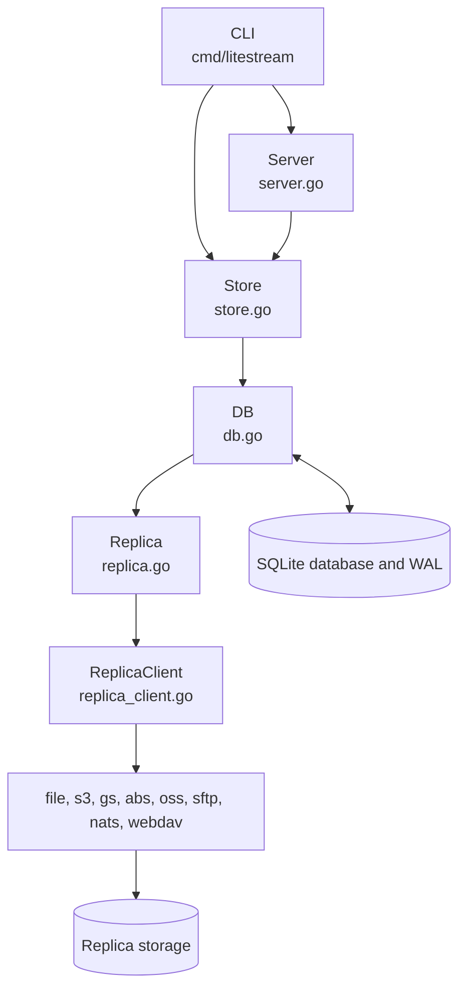
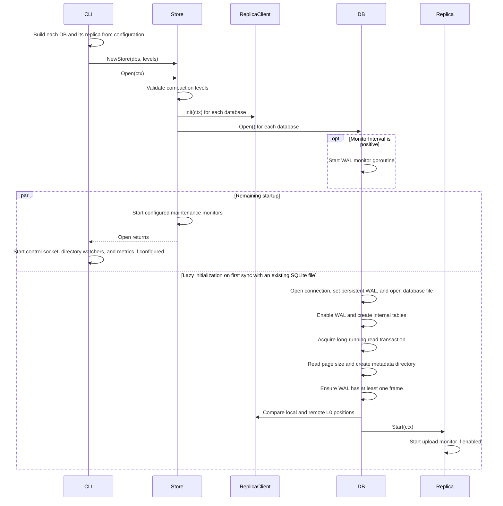

# Litestream Architecture

Mirrors `docs/ARCHITECTURE.md` in the Litestream repository. Plain source paths are relative to the repository root; links between bundled guides stay relative to this directory. Update both copies together.

Litestream captures committed SQLite writes as immutable LTX files and uploads them to one replica per database. Restore uses those files to reconstruct a database at the latest available transaction, a specified TXID, or a timestamp.

## System Layers

| Component | Responsibility | Source |
|-----------|----------------|--------|
| CLI | Parses configuration and builds database and replica objects | `cmd/litestream/main.go`, `cmd/litestream/replicate.go` |
| Store | Starts and stops databases, schedules maintenance, validates replica files, and coordinates operator requests | `store.go` |
| DB | Manages a SQLite connection, captures WAL changes, coordinates checkpoints, and creates snapshots | `db.go` |
| Replica | Uploads local L0 files, tracks remote position, and restores databases from replica storage | `replica.go` |
| ReplicaClient | Provides storage operations for file, S3, GCS, Azure Blob, OSS, SFTP, NATS, and WebDAV | `replica_client.go`, [Replica client guide](REPLICA_CLIENT_GUIDE.md) |
| Server | Handles runtime control over a Unix socket | `server.go` |

## Startup and Shutdown

The CLI configures each DB and its replica before creating a Store. `Store.Open(ctx)` validates compaction levels, initializes replica clients, and opens databases. Client initialization and database opening run in separate groups, each limited to 50 concurrent operations. The Store starts configured compaction, retention, heartbeat, and validation monitors. See `cmd/litestream/replicate.go` and `store.go`.

`DB.Open()` checks configuration and starts the WAL monitor if `MonitorInterval` is positive. The first sync that finds the SQLite file initializes the connection. `DB.init` enables WAL, acquires a long-running read transaction, reads the page size, creates local metadata, and checks the remote L0 position before it starts the replica monitor. The remote-position check refreshes local L0 metadata if the replica is ahead. Actual database restore is handled by `Replica.Restore`. See `db.go` and `replica.go`.

The diagram shows the successful replication startup path. A configured restore of a missing database runs before DB construction. Lazy initialization can overlap the remaining startup work; `Open` returning does not mean a replica is caught up. With the WAL monitor disabled, a caller's explicit sync performs initialization.

`DB.Close(ctx)` stops the DB monitor, attempts a final sync, releases the read transaction, and closes the database and replica resources. See `db.go`.

## WAL Monitoring and Checkpoints

`DB.monitor` calls `DB.Sync(ctx)` on the monitor interval. Sync processes committed WAL frames in bounded chunks, emits local L0 files, updates the local position and notifies the replica. The executor semaphore serializes work on the sync state and is released between bounded chunks. WAL capture must respect committed frame boundaries and skip SQLite's reserved lock page. See `db.go`, `wal_reader.go`, and [SQLite internals](SQLITE_INTERNALS.md).

The long-running read transaction prevents outside checkpoints from invalidating WAL data Litestream still needs. Other SQLite connections can continue writing. `DB.Checkpoint(ctx, mode)` coordinates under the executor semaphore. Checkpoint work skips a pass if a snapshot holds the checkpoint lock. The checkpoint path coordinates the read transaction, captures any required WAL data, and updates the sync state when the WAL restarts. See `db.go`.

The optional replica monitor uploads L0 files. It waits on the DB notification channel when caught up, and uses a timer for pacing and idle checks. Replica syncs use their own semaphore. Both background monitors apply rate-limited logging and exponential backoff on failures. See `replica.go` and `db.go`.

## Position and Restore

`DB.Pos()` obtains the local position from L0. `Replica.Pos()` returns its tracked upload position under a mutex. The `ltx.Pos` type contains the TXID and post-apply checksum. `DB.SyncStatus(ctx)` queries storage and compares the local and remote TXIDs. `DB.SyncAndWait(ctx)` runs local capture followed by upload. With a replica configured, `DB.EnsureExists(ctx)` can restore a missing database before `Open()` and returns successfully if no backup is available. See `db.go`, `replica.go`, and [LTX format](LTX_FORMAT.md).

The restore planner chooses a chain of LTX files that reaches the requested position. Initial restore uses resumable streams and writes the database to a temporary path before publishing it. Follow mode applies later changes and records the applied TXID in a sidecar. S3 and file replicas also support legacy v0.3.x backups. See `replica.go` and [Replica client guide](REPLICA_CLIENT_GUIDE.md#replicaclientv3-interface-v03x-restore).

## Compaction and Retention

L0 contains raw changes. The default compaction intervals are 30 seconds for L1, five minutes for L2, and one hour for L3. L9 contains full database snapshots, with a default interval and retention of 24 hours each. `Store.CompactDB` checks whether a level is due and has new data, then calls `DB.Compact` for ordinary levels or `DB.Snapshot` for L9. See `compaction_level.go`, `store.go`, and `db.go`.

`Compactor.Compact` enumerates source files beyond the destination level's latest TXID. It prefers a local copy if available and falls back to a resumable remote reader if the local file is missing. It streams the merged LTX to storage and caches the returned metadata. Storage clients preserve the timestamp in the merged LTX header. See `compactor.go` and [Replica client guide](REPLICA_CLIENT_GUIDE.md#file-timestamps).

L0 retention runs after L1 compaction and on a separate monitor. Snapshot retention uses a time cutoff, and retention for intermediate levels uses the oldest retained snapshot TXID. Disabling retention delegates replica deletion to provider lifecycle rules while preserving local cleanup. See `db.go`, `store.go`, and `compactor.go`.

## IPC Server and Control Socket

The control socket is disabled by default. Its default path is `/var/run/litestream.sock` and default permissions are `0600`. Restrict access through socket permissions. Endpoint registration and full request types are in `server.go`.

| Method | Path | Purpose |
|--------|------|---------|
| `POST` | `/register` | Add a database at runtime |
| `POST` | `/unregister` | Remove a database at runtime |
| `POST` | `/start` | Start replication for a database |
| `POST` | `/stop` | Stop replication for a database |
| `POST` | `/sync` | Capture pending changes and optionally wait for replica upload |
| `GET` | `/txid?path=` | Get the current local TXID for a database |
| `GET` | `/list` | List managed databases |
| `GET` | `/info` | Get version, process, uptime, and database count |
| `GET` | `/debug/sync-status` | Get per-database sync diagnostics |
| `GET` | `/debug/pprof/` | Access Go profiling endpoints |

## Distributed Leasing

The `Leaser` interface exposes `AcquireLease`, `RenewLease`, and `ReleaseLease`. The S3 implementation uses `If-None-Match: *` for the first acquisition, `If-Match` for expired-lease takeover and renewal, and a conditional delete for release. The default TTL is 30 seconds, the object name is `lock.json`, and the owner defaults to `hostname:pid`. A competing acquisition returns `LeaseExistsError`. A failed ownership check during renewal or release returns `ErrLeaseNotHeld`. The lease implementation is available for callers that need to coordinate ownership. See `leaser.go` and `s3/leaser.go`.

## Monitoring and Metrics

When configured with a metrics address, the CLI exposes Prometheus metrics at `/metrics`. DB metrics include `litestream_db_size`, `litestream_wal_size`, `litestream_total_wal_bytes`, `litestream_txid`, `litestream_sync_count`, `litestream_sync_error_count`, and `litestream_checkpoint_count`. See `cmd/litestream/replicate.go` and `db.go`.

Periodic validation checks non-snapshot levels for TXID consistency. Its metrics are `litestream_validation_checks_total` with a `result` label of `success`, `invalid`, or `error`, `litestream_last_validation_success`, and `litestream_last_validation_success_timestamp_seconds`. All three carry `db` and `level` labels. See `store.go`.
